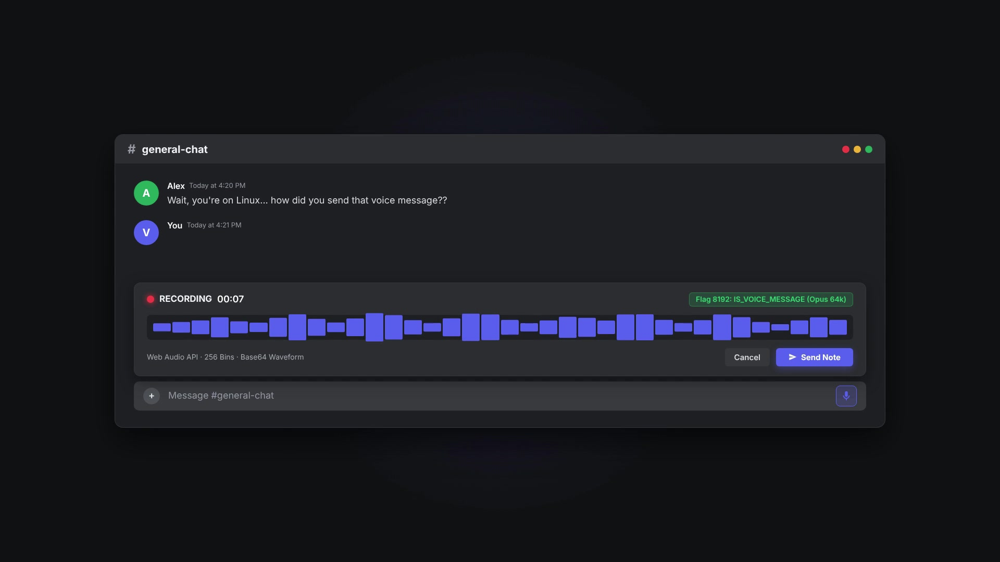

# Discord Voice Notes for Linux & Windows

A native add-on that enables users of the official Discord desktop application (Linux & Windows) to record, preview, and send native Discord voice messages with real-time waveform visualization, bypass upload limits, split long messages, and enjoy 83 glass themes.

<p align="center">
  <a href="docs/media/brag.mp4">
    
  </a>
</p>

<p align="center">
  🎬 <b><a href="docs/media/brag.mp4">Click to Watch Launch Demo Video (brag.mp4)</a></b> &bull; <i>Native voice messages, live waveform visualization, 200MB uploads, zero character limits & 83 glass themes</i>
</p>

## Key Features

- **Microphone Composer Button**: Injects an intuitive microphone icon adjacent to the Discord message composer.
- **Recording Controls**: Real-time timer, pulsating recording status indicator, stop, cancel, and preview playback.
- **Discord-Compliant Audio**: Encodes audio via Web Audio and MediaRecorder in Opus (`audio/ogg` or `audio/webm`) at 64 kbps.
- **Waveform Analysis**: Computes amplitude bins ($\le 256$ bins, ~10 samples/sec), normalizes via dynamic range expansion, and generates the exact Base64 waveform string required by Discord.
- **Native Voice Message Dispatch**: Transmits files using message flag `8192` (`IS_VOICE_MESSAGE`) along with duration and waveform metadata.
- **Normal Attachment Fallback**: Toggle to fall back to standard audio attachment upload if a channel restricts voice messages.
- **Auto Split Large Messages (No Character Limit)**: Built-in `SplitLargeMessages` plugin automatically intercepts messages exceeding Discord's 2,000 / 4,000 character limit and splits them into clean consecutive segments queued smoothly without API rate limits.
- **Large File Upload Bypasser (Catbox Direct)**: Built-in `CatboxUploadButton` plugin adds "Upload Large File (Catbox)" to Discord's `+` attachment menu, bypassing the 10MB/50MB upload limits for files up to 200MB+ and pasting the direct stream/download link.
- **DM Archive (Visual Transcript & Data Backup)**: Built-in `DMArchive` plugin exports full or filtered DM and Group DM conversation histories to standalone offline HTML transcripts (with dark theme, attachments, code syntax, and real-time offline search) or structured JSON backups. Supports date range filtering, attachment toggling, rate-limit backoff handling, and 100% local client export.
- **83 Full HD Themes & Real-Time Theme Search Bar**: Full glass transparency engine for voice channel overlays, video calls, participant user tiles, lobby/preview voice boxes (both connected and not connected), opened/expanded server folders, and chat styling across 83 unique wallpapers. Features zero-leakage active-theme scoping so vanilla Discord remains 100% stock and opaque when no theme is selected, plus an interactive real-time search bar in the Themes settings page to instantly filter themes by name, author, or keyword.
- **100% Client-Side & Secure**: Zero credential harvesting, zero token interception, and no external tracking servers.
- **Non-Invasive & Reversible**: Can be enabled, disabled, or completely uninstalled with single-line commands.

---

## Installation Guide

### Method 1: Linux Distributions (Debian, Arch, Ubuntu, Kali, Manjaro)

#### Option A: Arch Linux / Manjaro (Pacman / PKGBUILD)
1. **Install via Pacman package**:
   ```bash
   sudo pacman -U ./discord-voice-notes-1.0.0-1-any.pkg.tar.zst
   ```
2. **Or build using PKGBUILD**:
   ```bash
   cd arch && makepkg -si
   ```

#### Option B: Debian / Kali / Ubuntu (.deb)
1. **Install via APT / dpkg**:
   ```bash
   sudo apt install ./discord-voice-notes.deb
   # OR: sudo dpkg -i ./discord-voice-notes.deb && sudo apt install -f
   ```

#### Option C: Universal Multi-Distro Script (`setup.sh`)
On any Linux distribution (Arch, Debian, Ubuntu, Kali, Fedora, etc.):
```bash
sudo ./setup.sh
# OR after package installation:
sudo discord-voice-notes
```
This opens the interactive CLI menu:
- `[1]` Install Voice Notes, Unlimited Messages, Large File Upload & Vencord (Standard)
- `[2]` Install Voice Notes + Enable Free Nitro (FakeNitro & Profile Themes)
- `[3]` Install Custom Themes (83 Full HD Themes with Voice Channels & Chat Styling)
- `[4]` Run System Diagnostics (Doctor)
- `[5]` Restore Vanilla Discord (Unpatch / Revert)
- `[6]` Complete Clean Wipe (Remove All & Revert to Stock Vanilla)
- `[7]` Exit

#### Activation in Discord:
- Open Discord.
- In any chat, right-click the '+' attachment button:
  - **Send Voice Message**: Record and transmit voice audio notes.
  - **Upload Large File (Catbox)**: Bypass the 10MB/50MB file size restriction (up to 200MB+).
- In any Direct Message (DM), Group DM, or user context menu:
  - **Export DM History**: Open the DM Archive modal to export full or filtered message histories to responsive HTML transcripts and structured JSON backups.
- Paste or type text of any length; `SplitLargeMessages` automatically segments long messages.
- If FakeNitro was selected (Option `[2]`), cross-server emojis, stickers, and 1080p 60FPS streaming are pre-configured and active!

---

### Method 2: Windows Native CLI Installer (.exe)

For Windows 10/11 users, a standalone native Windows executable is included:

1. Run `DiscordVoiceNotesInstaller.exe`.
2. Select from the interactive menu:
   - `[1]` Install Voice Notes, Unlimited Messages, Large File Upload & Vencord Runtime
   - `[2]` Install Voice Notes + Enable Free Nitro (FakeNitro)
   - `[3]` Install Custom Themes (83 Full HD Themes)
   - `[4]` Run Diagnostics & Doctor check
   - `[5]` Restore Vanilla Discord (Unpatch)
   - `[6]` Exit
3. The tool automatically locates Discord in `%LOCALAPPDATA%\Discord\app-*`, patches it offline, enables `VoiceMessages`, `SplitLargeMessages`, `CatboxUploadButton`, and `FakeNitro` in Vencord settings, deploys custom themes, and configures the environment.

#### Windows 11 Smart App Control (SAC) Note:
If Windows 11 displays a message such as *"Smart App Control blocked an app that may be unsafe"* when running `DiscordVoiceNotesInstaller.exe`:
1. **Unblock via File Properties**: Right-click `DiscordVoiceNotesInstaller.exe` -> select **Properties** -> at the bottom of the **General** tab, check the **☑ Unblock** checkbox -> click **Apply** / **OK**.
2. **Or Toggle Smart App Control**: In Windows Settings, navigate to **Privacy & security** -> **Windows Security** -> **App & browser control** -> **Smart App Control settings** and set it to **Evaluation** or **Off**.

---

### Vencord Free Nitro & Profile Themes

When Option `[2]` (or `--nitro`) is selected, Vencord's built-in **`FakeNitro`** and **`FakeProfileThemes`** are pre-configured:

- **Cross-Server Emojis**: Send custom animated and static emojis from any server without a Nitro subscription. Vencord intercepts and transforms them into high-quality Discord CDN links or hyperlinks.
- **Custom Stickers**: Access and send custom stickers across all chats.
- **1080p 60FPS / Source Streaming**: Unlocks high-definition, high-framerate screensharing in voice channels and direct calls.
- **Fake Profile Themes**: Customize gradient accents on your profile visible to other users.

---

### Vencord Custom User Plugin: DM Archive

The built-in **`DMArchive`** plugin provides complete, offline export of individual Discord DM and Group DM conversations without relying on bot tokens, external services, or scraping:

1. **User Interface & Context Menus**:
   - Right-click any DM in the channel sidebar or channel header -> **Export DM History**.
   - Right-click any Group DM -> **Export Group DM History**.
   - Right-click any user profile -> **Export DM History**.
   - Interactive glass-styled modal opens with real-time conversation preview (recipients, conversation type, channel ID).

2. **Supported Formats**:
   - **HTML (Visual Interactive Transcript)**: Discord-accurate dark theme styling with message grouping, avatars, Markdown formatting, embeds, images, attachment links, and instant offline search filtering.
   - **JSON (Structured Data Backup)**: Machine-readable schema including author profiles, timestamps, edited timestamps, reply references, attachments, and embeds.
   - **Both**: Exports both formats simultaneously with identical retrieved datasets.

3. **Message History & Pagination**:
   - Uses Discord client internal REST client (`/channels/{id}/messages`) with backward pagination (`limit: 100`, `before: message_id`).
   - Deduplicates messages using unique snowflake sets (`seenIds`) and sorts results chronologically (oldest to newest).
   - Gracefully handles HTTP 429 rate limits using exponential backoff (`retry_after` countdown displayed live in the UI).
   - Supports user cancellation anytime during multi-batch fetches.
   - **Guaranteed Transparency**: Clearly tags archives as `✓ Complete Archive` or `⚠ Partial Archive` in both metadata and transcript banners, never claiming partial downloads are complete.

4. **Filtering & Privacy Guarantee**:
   - **Date Range**: Optional Start Date and End Date filters to export specific timeframes.
   - **Attachments**: Toggle to include or exclude attachment media links and previews.
   - **Custom Filenames**: Custom name override or auto-generated `{channel_name}_{timestamp}` naming.
   - **100% Client-Side Privacy**: Exports are generated entirely within the client via JavaScript Blobs and native browser download triggers. Message content and tokens are never sent to any external server.

---

### Method 3: Manual / Development Installation

```bash
# Clone or extract archive
cd discord-voice-notes

# Install build dependencies
npm install

# Compile plugin bundles
npm run build

# Run automated tests
npm test

# Copy pre-compiled plugin to your user profile
bash scripts/install.sh --userplugin
```

---

## Command Line Reference

The `discord-voice-notes` CLI utility provides the following actions:

| Command | Description |
|---|---|
| `discord-voice-notes --doctor` | Performs a system diagnosis of OS, Node, audio daemons, Discord client, and Vencord. |
| `discord-voice-notes --userplugin` | Copies pre-compiled plugin to `~/.config/Vencord/userplugins/DiscordVoiceNotes`. |
| `discord-voice-notes --setup-vencord` | Downloads official Vencord installer CLI, patches Discord, and registers plugin. |
| `discord-voice-notes --vencord-src <DIR>`| Copies plugin source into a local clone of Vencord (`src/userplugins/`). |
| `discord-voice-notes --restore` | Reverts all client modifications and restores Discord to its original vanilla state. |
| `discord-voice-notes --help` | Displays command line usage information. |

---

## Project Structure

```
discord-voice-notes/
├── README.md               # User manual and setup documentation
├── LICENSE                 # MIT Open Source License
├── CHANGELOG.md            # Version changelog
├── Makefile                # Build automation targets
├── package.json            # Node project configuration and dependencies
├── tsconfig.json           # TypeScript strict compiler configuration
├── src/
│   ├── audio/              # Audio recording & waveform calculation
│   │   ├── recorder.ts     # MediaRecorder & Web Audio lifecycle controller
│   │   └── waveform.ts     # RMS waveform generation & Base64 encoding
│   ├── discord/            # Discord API & upload integrations
│   │   ├── types.ts        # Message flags (IS_VOICE_MESSAGE = 8192) & types
│   │   └── uploader.ts     # CloudUpload and message posting integration
│   ├── components/         # React UI components
│   │   ├── Icons.tsx       # Microphone, wave, and control SVG icons
│   │   ├── VoiceNotes.css  # Native Discord styling & animations
│   │   └── VoicePanel.tsx  # Floating recording & preview panel
│   ├── plugin/             # Vencord plugin registration
│   │   ├── VoiceBarButton.tsx # Toolbar composer button injection
│   │   └── index.ts        # Main Vencord plugin export
│   └── plugins/            # Additional custom Vencord plugins
│       └── dmArchive/      # DM Archive plugin (history fetcher, formatters, modal)
│           ├── types.ts    # Archive data structures & filter options
│           ├── fetcher.ts  # History pagination, rate limit backoff & deduplication
│           ├── formatters.ts # Responsive HTML transcript & JSON backup generators
│           └── index.ts    # Vencord plugin export & context menu integrations
├── tests/                  # Automated unit & integration test suite
│   ├── waveform.test.ts    # Waveform and Base64 algorithm tests
│   ├── recording.test.ts   # Audio controller state machine tests
│   ├── protocol.test.ts    # Discord protocol & upload tests
│   ├── split-large-messages.test.ts # Smart message splitting & formatting tests
│   └── dm-archive.test.ts  # DM export pagination, filtering & format tests
├── themes/                 # Modernized Vencord custom themes
│   ├── NewKemonoFriends.theme.css  # Fixed & modernized Kemono Friends theme
│   ├── GGOKirito.theme.css         # Fixed & modernized GGO Kirito theme
│   ├── OldAkameGaKill.theme.css    # Fixed & modernized Old Akame Ga Kill theme
│   ├── NewAkameGaKill.theme.css    # Fixed & modernized New Akame Ga Kill theme
│   └── assets/             # Bundled CSP-friendly assets & background images
├── scripts/                # Utility and administration scripts
│   ├── build.sh            # Bundles TypeScript to ESM & CJS via esbuild
│   ├── package.sh          # Builds Debian .deb package
│   ├── doctor.sh           # System health and diagnostic checker
│   ├── install.sh          # Plugin installation assistant
│   ├── uninstall.sh        # Uninstaller script
│   └── restore-discord.sh  # Vanilla Discord restoration script
├── arch/                   # Arch Linux packaging definitions
│   ├── PKGBUILD            # makepkg build recipe
│   └── discord-voice-notes.install # Arch post-installation hook
├── debian/                 # Debian packaging definitions
    ├── control             # Package dependencies and metadata
    ├── rules               # debhelper build rules
    ├── postinst            # Post-installation hook
    ├── prerm               # Pre-removal hook
    └── copyright           # Debian copyright declaration
```

---

## Command Line Flags & Options (`setup.sh`)

Both `setup.sh` and the installed `discord-voice-notes` command support full CLI flags:

| Flag | Short | Action |
|------|-------|--------|
| `--install` | `-1`, `-i`, `--standard` | Standard Voice Notes & Vencord offline install |
| `--nitro` | `-2`, `-n`, `--fake-nitro` | Voice Notes + auto-enable Free Nitro (FakeNitro & Profile Themes) |
| `--themes` | `-3`, `-t` | Deploy all 4 bundled custom themes to Vencord (`~/.config/Vencord/themes/`) |
| `--doctor` | `-4`, `-d`, `--diagnostics` | Run comprehensive system diagnostics and audio checks |
| `--restore` | `-5`, `-r`, `--revert` | Restore Discord to stock vanilla state (unpatch) |
| `--clean` | `-6`, `-c`, `--wipe` | Complete clean wipe (restores Discord, removes Vencord, clears caches) |
| `--non-interactive` | `-y`, `--yes` | Run unattended in batch mode without interactive confirmation prompts |
| `--help` | `-h` | Display complete help and usage documentation |

---

## Custom Themes (Full GGO Engine & DM Transparency)

All four themes in `themes/` are built on the proven **GGO Kirito glass engine** and share full transparency architecture across all views:

- **Complete Direct Message (DM) Transparency**: Fully fixes the DM tab side panel, friends list, and private conversation views so wallpapers display seamlessly without solid pitch-black overlays (`.homeWrapper__0920e`, `#app-mount .privateChannels`, and `.sidebar_c48ade` are 100% translucent).
- **High-Contrast Text Readability**: Enforces bright white typography (`--text-normal: #ffffff`) with subtle drop shadows (`text-shadow: 0 1px 2px rgba(0,0,0,0.7)`), guaranteeing message clarity over any background image.
- **Server Channels & Members Slider**: Smooth hover slide animation for member lists, translucent category headers, and animated voice chat speaking indicators.
- **Translucent Popouts & Profiles**: Glass modal windows and user profile cards with custom accent palettes.

### Available Themes:
- **New Kemono Friends Theme (`themes/NewKemonoFriends.theme.css`)**:
  - Warm Japari Park amber & rose palette (`#ff7b54` / `rgba(204, 102, 119, 0.6)`).
  - High-res Kemono Friends anime wallpaper with full DM panel transparency.
- **GGO Kirito Theme (`themes/GGOKirito.theme.css`)**:
  - Crimson sniper aesthetic with Kirito & Death Gun battle wallpaper (`red` / `rgba(100, 0, 0, 0.6)`).
  - High-res 2834×1464 background with zero external CDN dependencies.
- **Old Akame Ga Kill Theme (`themes/OldAkameGaKill.theme.css`)**:
  - Assassin crimson & shadow noir palette (`#e63946` / `rgba(150, 20, 30, 0.6)`).
  - High-res 1920×1080 Akame wallpaper with modernized visual refresh support.
- **New Akame Ga Kill! Theme (`themes/NewAkameGaKill.theme.css`)**:
  - Night Raid Murasame ruby & dark blood palette (`#c0122e` / `rgba(160, 0, 50, 0.6)`).
  - High-res 2000×1200 background asset with custom glass transparency.

### How to Install Themes:
- **Automatic**: Run `sudo ./setup.sh --themes` (or select Option `[3]` in the interactive menu). Deploys directly to Vencord (`~/.config/Vencord/themes/`).
- **Manual**: Copy any `.theme.css` file into your themes folder.
- In Discord, go to **User Settings** -> **Vencord** -> **Themes** and toggle on your desired theme. Press `Ctrl+R` to reload.

---

## Restoration & Complete Wipe

To return Discord to its vanilla state:
```bash
sudo ./setup.sh --restore
# OR: discord-voice-notes --restore
```

To **completely wipe** all Vencord runtime, plugins, themes, and caches for a fresh start:
```bash
sudo ./setup.sh --clean
```

To remove the Debian package:
```bash
sudo apt purge discord-voice-notes
```

---

## License

This project is licensed under the [MIT License](LICENSE).
